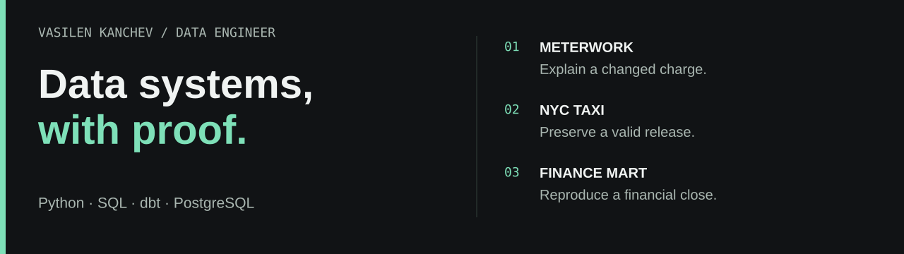

**Data Engineer | Python, SQL, dbt & PostgreSQL | Revenue & Billing Data Systems**

I build data systems that make changed numbers explainable and failed updates recoverable. At Gosian, I own daily cash-flow reporting; I progressed from Data Engineer to Chief Revenue Officer and continued hands-on engineering. I am seeking a dedicated Data Engineer or Analytics Engineer role.

**Porto, Portugal · EU citizen · Full-time remote roles with teams that hire in Portugal.**

[Portfolio](https://vasilendata.github.io/) · [DE CV](https://vasilendata.github.io/vasilen-kanchev-cv.pdf) · [AE CV](https://vasilendata.github.io/vasilen-kanchev-cv-analytics.pdf) · [LinkedIn](https://www.linkedin.com/in/vasilenkanchev/) · [Email](mailto:vasilen.business@gmail.com)

### Meterwork · explain a changed charge
Python/PostgreSQL usage ledger with historical pricing and retry-safe events. **72 revisions across 24 synthetic accounts** reconciled to independent SQL. A local two-worker exercise tests shared quotas and a retry after an observed commit and worker kill.

[View the result](https://vasilendata.github.io/usage-metering-platform/#reconciliation) · [Inspect the engineering](https://github.com/VasilenData/usage-metering-platform)

### NYC Taxi · preserve valid reporting after failure
Dagster/dbt pipeline: **31.6M historical trips** reconciled locally; eight tables publish together. A separate **30K-row** exercise records a rejected candidate, preserved output and recovery. AWS remains undeployed.

[View the result](https://vasilendata.github.io/projects/nyc-taxi/) · [Inspect the engineering](https://github.com/VasilenData/nyc-taxi-data-platform)

### Finance Mart · reproduce a financial close
SQL/Excel reporting over **1.07M public invoice lines**, with **124 passing comparisons**. Separate synthetic dbt models test corrections, versioned metrics, frozen releases and rollback on DuckDB and PostgreSQL.

[View the result](https://vasilendata.github.io/ecommerce-finance-mart/explorer/) · [Inspect the engineering](https://github.com/VasilenData/ecommerce-finance-mart)

[Run one focused proof per project](https://vasilendata.github.io/proof/) · [Professional case study](https://vasilendata.github.io/gosian/)

**Professional tools:** Python, SQL, dbt, PostgreSQL, AWS RDS, Docker, Tableau and Excel.

Project implementation and review are AI-assisted. Local/synthetic exercises and read-only demos are labelled; they do not imply production adoption or independent review.
